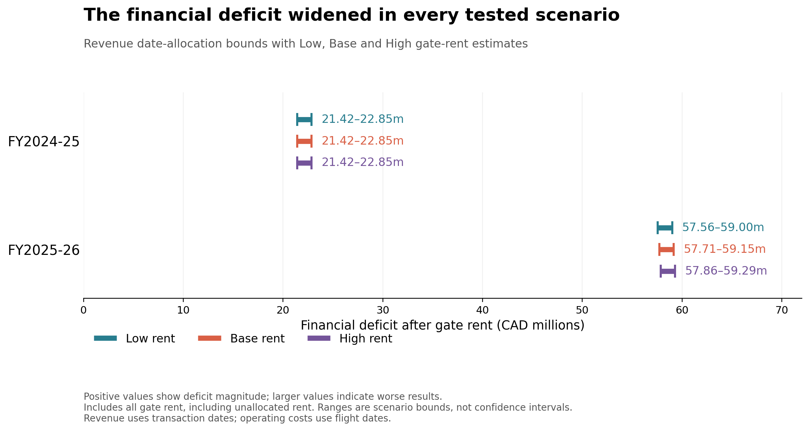
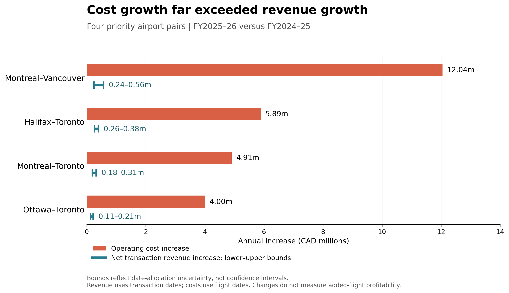
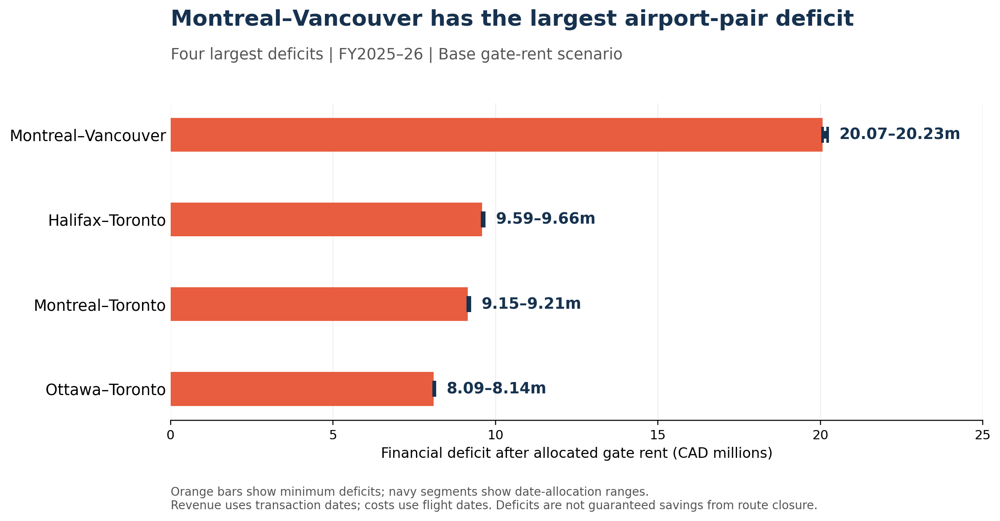

# NorthByte Airline Financial Analysis

**First Byte Datathon 2026 · Semi-finalist · October 2026**

An airline case study investigating why revenue growth failed to translate into stronger financial performance. In a four-person team, I served as **Team Lead & Data Analyst**, authored the operating-cost and integration notebooks, and coordinated analysis integration, slide development, presentation preparation and Q&A.

**Tools:** Python, pandas, NumPy, Matplotlib and Google Colab.

## Business question

Which parts of the airline's network deserve priority review, and under what conditions would reducing flight frequencies improve the financial result?

The case covers September 2024–August 2026 and combines customer transactions, flight operating costs and airport gate leases. This was a competition case, not an engagement for a real airline client.

## At a glance

| Scope | Outcome | Verification |
|---|---|---|
| 3 case workbooks · 28,801 inferred flights · 558,129 deduplicated transactions | Four priority airport pairs identified for closer review | 26 archived output tables matched in a post-competition local run |

The company-level annual deficit rose from about **CAD 21.42–22.85M** in FY2024–25 to **CAD 57.56–59.29M** in FY2025–26 across the tested date-allocation and gate-rent assumptions. The ranges describe model assumptions, not statistical confidence intervals.

## Selected findings

| Finding | Interpretation |
|---|---|
| 15 of 27 airport pairs had negative results across all tested date and rent scenarios in FY2025–26 | A starting point for investigation, not an automatic closure recommendation |
| Four priority pairs added 1,189 flights, with CAD 26.84M higher operating costs and about CAD 0.80–1.46M higher net revenue | Expansion warranted review; annual comparisons do not identify the causal return of each added flight |
| Fuel, crew and maintenance explained 96.8% of operating-cost growth on the four pairs | The largest areas for cost investigation, not an achievable savings percentage |

### Where did the gap widen?

The four priority pairs saw much larger increases in operating costs than in net transaction revenue. Revenue bounds reflect uncertainty in assigning transaction dates; costs use flight dates. This comparison does not measure the profit of an individual added flight.

Under the Base gate-rent scenario, Montréal–Vancouver had the largest estimated airport-pair deficit. A route deficit alone does not establish that removing the route would save that amount.

## Frequency-reduction sensitivity

We modelled the removal of **468 annual flights**, approximately 10% across four priority airport pairs. Removed flights were assigned each pair's annual average revenue and operating cost, while gate rent stayed unchanged.

| Assumed operating-cost avoidability | Modelled annual financial improvement CAD |
|---|---:|
| 40% | −749,425 to −716,421 |
| 60% | +970,246 to +1,003,250 |
| 80% | +2,689,917 to +2,722,921 |

**Main insight:** fewer flights can worsen the result if too few costs actually disappear. These are conditional annual scenarios, not forecasts or realized savings. Even the 80% case addresses only roughly 5% of the current Base annual shortfall; it does not establish a complete turnaround.

The recommendation was to pause further frequency expansion on the four priority pairs, validate flight-specific costs and revenue at risk, and run feasible pilots with explicit review gates.

## Explore the analysis

- [Annual financial results](results/integration/company_fiscal_results.csv) — company-level fiscal deficit across date and rent assumptions.
- [Four priority airport pairs](results/integration/priority_pair_comparison.csv) — flight growth, revenue and operating-cost comparison.
- [Frequency sensitivity](results/integration/frequency_adjustment_totals.csv) — combined 40/60/80% avoidable-cost scenarios.
- [Operating costs by fiscal year](results/operating_costs/annual_comparison.csv) and [cost growth by category](results/operating_costs/cost_increase_breakdown.csv).

These are archived output tables from the competition analysis; the original notebooks and their input limitations are documented below.

## Repository guide

| Path | Contents |
|---|---|
| [`data/raw/`](data/raw/) | Original `transactions.xlsx`, `costs.xlsx`, and `gates.xlsx` case workbooks |
| [`results/`](results/) | Archived financial, scenario and operating-cost reference tables |
| [`scripts/reproduce.py`](scripts/reproduce.py) | Post-competition runner for selected notebook calculation cells |
| [`docs/reproduce.md`](docs/reproduce.md) | Exact inputs, local commands, validation and limitations |
| [`docs/validation_2026-10-19.json`](docs/validation_2026-10-19.json) | Recorded 26-table post-competition local validation |
| `notebooks/01_operating_costs.ipynb` | Operating-cost cleaning, aggregation and cost comparisons |
| `notebooks/02_team_integration.ipynb` | Integration of teammate revenue/gate outputs, financial comparisons and scenario modelling |
| `docs/methodology.md` | Calculation rules and interpretation limits |
| `docs/data_access.md` | Inputs and current reproduction status |
| `docs/retrospective.md` | Judge questions and planned improvements |
| `CONTRIBUTIONS.md` | Individual and team responsibilities |
| `requirements.txt` | Core analysis dependencies; original versions not pinned |

## Reproduction status

The notebooks were recovered from the competition archive. For this repository, execution outputs and environment metadata were removed; source cells were preserved. **A post-competition local run matched 26 archived output tables, conditional on the archived teammate revenue/gate inputs. This is not a raw-workbook-to-results end-to-end run.**

The historical notebooks use Google Colab upload/download helpers. The separate [local verification runner](scripts/reproduce.py) executes selected calculation cells without those prompts. The archived CSV inputs and reference tables are included in this repository; [`docs/reproduce.md`](docs/reproduce.md) gives exact paths and commands. Review [`docs/data_access.md`](docs/data_access.md) for data provenance.

The three original case workbooks are available in [`data/raw/`](data/raw/): [transactions](data/raw/transactions.xlsx), [costs](data/raw/costs.xlsx), and [gates](data/raw/gates.xlsx). The archived teammate-derived input tables are included for the post-competition verification runner; their upstream construction from raw workbooks has not been reproduced here. The full team presentation is not included. No redistribution licence is granted for the case data or teammate materials.

## What I learned

The judges asked about the 40/60/80% assumptions, confidence in the recommendations, implementation through leadership, and further loss-reduction options. The experience highlighted the distinction between a sensitivity analysis and an executable business case. See [`docs/retrospective.md`](docs/retrospective.md) for proposed next steps, separate from completed competition work.

## Author

[Kevin Li](https://github.com/Kevin968k) · UBC Statistics

See [`CONTRIBUTIONS.md`](CONTRIBUTIONS.md) for attribution. No redistribution licence is granted for competition data or teammate materials by this repository.
